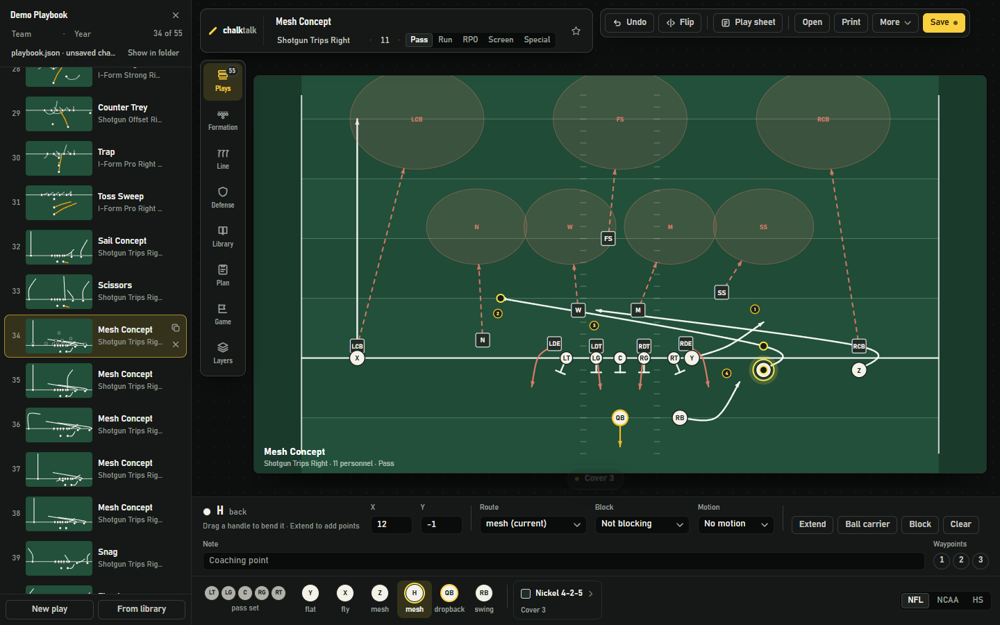
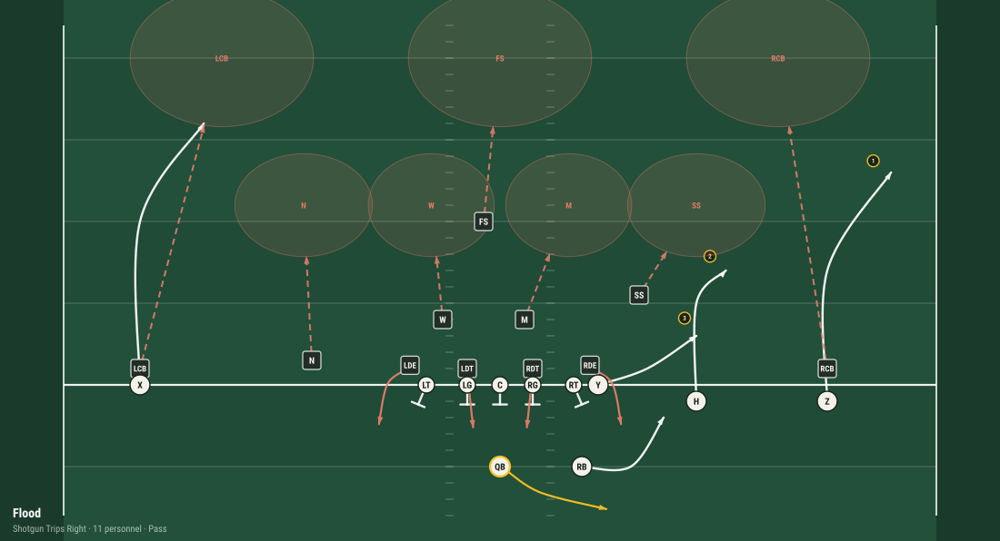
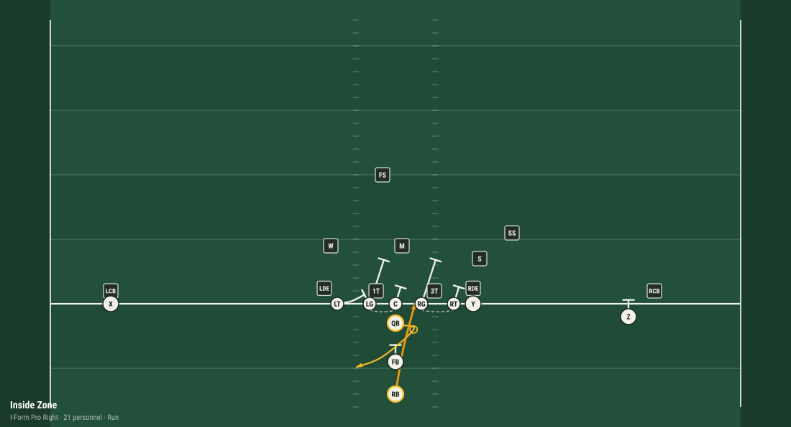
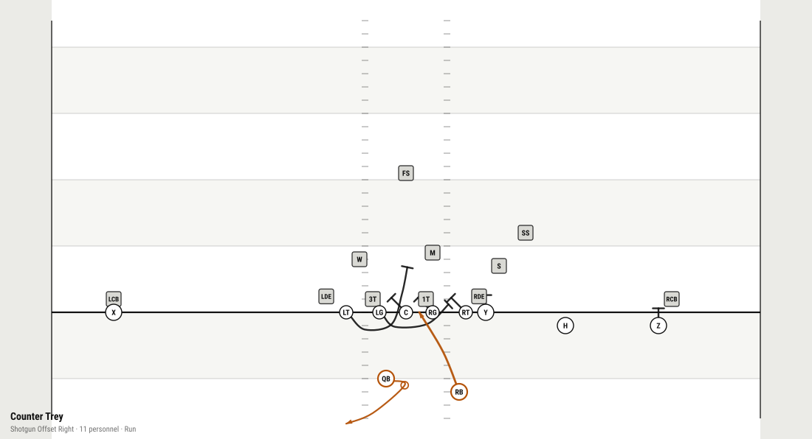

# chalktalk

[](https://github.com/matthewbakerthompson/chalktalk/actions/workflows/tests.yml)
[](https://pypi.org/project/chalktalk/)
[](https://pypi.org/project/chalktalk/)
[](https://polyformproject.org/licenses/noncommercial/1.0.0)

Football plays and playbooks in Python, with a designer that runs in your
browser.



Plays are Pydantic models stored as JSON. The library builds plays from
formations, routes, blocking schemes and quarterback actions, draws them as
SVG, PDF and HTML, and produces call sheets, practice scripts, wristbands,
install plans and game plans from a playbook. `chalk design` runs the
designer on your own computer and saves the same JSON files the library
reads.

<p>
  
  
  
</p>

Flood against Cover 3, Inside Zone against a 4-3 Over, and Counter Trey in
the print theme, as the library draws them. `python examples/readme_images.py`
redraws them into `docs/images/`.

Requires Python 3.10 or later. Licensed under PolyForm Noncommercial 1.0.0
(see License, below).

## Install

1. **Get Python 3.10 or later** if the computer doesn't have it. On Windows
   and macOS, download it from
   [python.org/downloads](https://www.python.org/downloads/); on Windows, tick
   **Add python.exe to PATH** on the installer's first screen. Most Linux
   systems already have it.

2. **Install chalktalk.** Open a terminal (on Windows, *Terminal* or *Command
   Prompt* from the Start menu; on macOS, *Terminal* in Applications >
   Utilities) and run:

   ```bash
   python -m pip install chalktalk
   ```

   On Windows, use `py` in place of `python` if `python` isn't found. On
   macOS and Linux, use `python3`.

3. **Make a shortcut** (optional):

   ```bash
   python -m chalktalk shortcut
   ```

   This adds a Chalktalk icon to the desktop and the Start menu on Windows,
   to the Applications folder in your home folder on macOS, and to the
   applications menu on Linux. Double-click it to open the designer; the
   terminal isn't needed after this.

chalktalk depends on `pydantic`, and on `reportlab` for PDF output. The
designer uses only the standard library and makes no requests outside the
computer.

To upgrade, run `python -m pip install --upgrade chalktalk`. To uninstall,
run `python -m chalktalk shortcut --remove`, then
`python -m pip uninstall chalktalk`. Playbooks stay in `Documents/chalktalk`.

To work on chalktalk itself:

```bash
git clone https://github.com/matthewbakerthompson/chalktalk
cd chalktalk
python -m pip install -e ".[dev]"
```

## Quick start

```bash
chalk                        # what chalktalk does, and its commands
chalk design week3.json      # edit a playbook in the browser; Save writes week3.json
chalk book week3.json        # print it to PDF
chalk demo --out out/        # a sample playbook, call sheet, wristband and script
```

`chalk` and `python -m chalktalk` are the same command. If the terminal says
`chalk` isn't found, use `python -m chalktalk design` and so on.

```python
from chalktalk import adjustments as A
from chalktalk.catalog import passing
from chalktalk.templates import routes as R

mesh = passing.mesh_concept()
mesh.render(level="hs").save("mesh.svg")

third_down = mesh.adjust(A.PROTECTION("Slide Rt"), A.MOTION("Z", "jet"), A.TAG("Y", R.CORNER()))
print(third_down.call)
# Shotgun Trips Right Mesh Concept Slide Rt Z Jet Y Corner
```

## Plays

### Formations and stock plays

Stock plays are in `chalktalk.catalog` (`passing`, `running`, `redzone`,
`playaction`, `screens`, `rpo`). Formations, routes, defensive fronts,
coverages, blocking schemes and quarterback actions are in
`chalktalk.templates`. `chalk list KIND` prints what is available, where KIND
is `plays`, `formations`, `defenses`, `routes`, `series`, `systems`, `schemes`,
`blocks`, `coverages` or `qb`.

```python
from chalktalk.catalog import passing, running, playaction, screens, rpo
from chalktalk.templates import formations as F

iz = running.inside_zone()
iz_gun = running.inside_zone(formation=F.GUN_DOUBLES())
smash_left = passing.smash().mirror()
boot = playaction.pa_boot()
slip = screens.rb_slip()
glance = rpo.glance()
```

`catalog.all_plays()` returns every stock play keyed by name. The command line
and the designer use the same dictionary.

To build a play from scratch:

```python
from chalktalk import build_play
from chalktalk.models import PlayType
from chalktalk.templates import formations as F, routes as R

play = (
    build_play(F.SHOTGUN_TRIPS_RIGHT())
    .block_ol()
    .routes(X=R.FLY(), Y=R.FLAT(), Z=R.MESH(), H=R.MESH(depth=6), RB=R.SWING())
    .name("Mesh").play_type(PlayType.PASS).tag("mesh", "third-down")
    .build()
)
```

Plays are immutable: every method that changes a play returns a new one.

### Coordinates

The origin is the center of the line of scrimmage, +x is the offense's right
and -y is the offensive backfield. Routes are written for a player on the
right and mirrored for players on the left by
`Assignment.absolute_waypoints()`, which the designer and the renderers both use.
Block paths and defensive paths are not mirrored: a pull to the right is a
pull to the right for either guard. `Play.mirror()` flips them explicitly.

### Adjustments

A variant is a base play plus a list of adjustments. Adjustments are
serializable objects; each one adds its text to the play call.

```python
from chalktalk import adjustments as A

mesh.adjust(A.MOTION("Z", "jet"))        # jet, orbit, across, return, short, out, in
mesh.adjust(A.SHIFT("Y", -7.0, 0.0))
mesh.adjust(A.FLIP())                    # mirror; "Right" becomes "Left"
mesh.adjust(A.MAX_PROTECT("RB"))
mesh.adjust(A.PLAY_ACTION("RB"))
mesh.adjust(A.TEMPO("no_huddle"))

A.variants(mesh, A.FLIP(), A.MOTION("Z", "jet"), A.MAX_PROTECT())      # one variant each
A.matrix(mesh, [A.FLIP()], [A.MOTION("Z", "jet"), A.MOTION("H", "orbit")])
```

Motion is drawn as a dashed trail from the pre-snap position.

### Blocking

```python
from chalktalk.templates import schemes as S, blocking as B

power = running.power_right().with_scheme(S.power(+1), protection="Power Rt")
power = power.with_block("LG", B.WRAP(+1, target="M"))
```

`with_scheme()` assigns the whole line and `with_block()` one player. Schemes
take a direction, `+1` for right and `-1` for left, and assign playside and
backside from it. Diagrams use standard notation: a bar at the end of an
engaged block, a curve behind the line for a puller, a bracket for a double
team.

### Quarterback

```python
from chalktalk.templates import qb as Q

play = play.with_qb(Q.GUN(3, reads=["Y", "H", "Z", "RB"], rule="High-low the flat defender"))
play = play.progression("Z", "Y", "RB")     # reorder the reads
play.read_order("Z")                        # 1

Q.PLAY_ACTION(+1, back="RB", steps=5)
Q.MESH(+1, back="RB", key="the backside end")
```

The quarterback's plan holds the drop or run action, the read progression and
an optional progression per coverage (`QBPlan.reads_vs`). Reads are drawn as
numbered markers at each route's catch point. Run actions mark the mesh point.

### Defense

```python
from chalktalk.templates import coverages as C, defense as D

play = play.vs(D.NICKEL_425(), C.cover_3)   # a front and a coverage call
play = play.with_coverage(C.cover_1)
C.line_game(C.cover_3(D.NICKEL_425()))      # a line game over a coverage
```

Zone defenders drop to landmarks computed from the field level and the hash.
In man coverage, corners take the widest receiver on their side and work
inside; a spare defender becomes a rat or, in a pressure call, a rusher.
Repeated positions get an alignment prefix so every defender has a unique
label (`LDE`, `RDE`, `LCB`, `RCB`).

## Series, scripts and call sheets

### Series

A series is a base play and the plays that answer the defense's adjustments to
it. Each entry records its tell: the defensive behavior that calls for it.

```python
from chalktalk.series import series

iz = (
    series("Inside Zone Series", "Everything off the same mesh point")
    .base(running.inside_zone(), note="Track the double team")
    .constraint(running.speed_sweep(), tell="Backside LB fast-flowing inside")
    .play_action(passing.y_cross().adjust(A.PLAY_ACTION("RB")),
                 tell="Safeties triggering downhill")
    .shot(passing.four_verticals(), tell="Single high, FS cheating the box")
    .build()
)

iz.describe()
iz.install(days=3)          # teaching order
iz.to_script(reps=2)        # practice script
iz.render_all("out/iz")     # one SVG per play
```

Nine stock series are in `chalktalk.catalog.series`.

### Series sets

A series set is several series with an install schedule, one practice script
and one call sheet.

```python
from chalktalk.series import series_set
from chalktalk.catalog import series as SR

system = (
    series_set("Base Offense")
    .add(SR.inside_zone_series(), install_week=1)
    .add(SR.mesh_series(), install_week=1)
    .add(SR.power_counter_series(), install_week=2)
    .add(SR.play_action_series(), install_week=2)
    .team("Riverside HS", 2026)
    .build()
)

system.install(weeks=4)     # every base play before any constraint play
system.to_practice(week=1)  # one period per series
system.to_call_sheet()      # every play, grouped by situation
system.balance()            # run/pass, personnel, answers per base play
system.gaps()               # ['Mesh Series: nothing that goes over the top']
system.save_html("install.html")
```

`gaps()` lists what the set has no answer for: a series with no deep shot, a
base play with no constraint play, a heavy run or pass lean. Four stock sets
are in `chalktalk.catalog.systems`.

```bash
chalk list systems
chalk system pro_style --balance
chalk system base_offense --out out/install
```

### Scripts, call sheets and wristbands

```python
from chalktalk.script import Script, PracticeScript
from chalktalk.callsheet import CallSheet, Wristband
from chalktalk.models import Playbook, situation as S
from chalktalk.templates import defense as D

openers = (
    Script(name="Opening 15", opponent="Central")
    .add(passing.mesh_concept(), S.FIRST_TEN, looks=[D.NICKEL_425()])
    .add(running.inside_zone(), S.SECOND_MEDIUM)
    .alternate_hashes()
)
print(openers.table())
print(openers.balance())

practice = (
    PracticeScript(name="Tuesday", team="Riverside HS")
    .add_period("Inside Run", iz.to_script(), minutes=12, focus="Zone tracks")
    .add_period("7-on-7", SR.mesh_series().to_script(reps=2), minutes=15)
)

book = Playbook.load("week3.json")
sheet = CallSheet.from_playbook(book, name="Week 3").number()
band = Wristband.from_call_sheet(sheet)     # same numbers as the call sheet
sheet.save_html("out/call_sheet.html")
band.save_html("out/wristband.html")
```

`Situation` holds down, distance, field position, hash, tempo and clock, and
decides which section of the call sheet a play goes in:

```python
S.Situation(down=3, distance=5, yard_line=32).describe()   # '3rd & 5, Opp 32'
S.Situation.own(25)                                        # ball on the offense's 25
S.Situation.opp(8).zone                                    # FieldZone.LOW_RED
```

## The designer

```bash
chalk design week3.json            # edit a playbook; Save creates it if it doesn't exist
chalk design my_play.json          # or a single play
chalk design mesh_concept          # start from a stock play
chalk design                       # the playbook folder
chalk design --folder ~/scouting   # another folder
chalk design --level hs --no-open  # high school hashes; don't open a browser
```

`chalk design` starts a server on 127.0.0.1, port 8765 or the next free port,
and opens it in the browser. It runs until Ctrl+C. With `--quiet`, which the
shortcut uses, it exits about a minute after the last page is closed. Every
request must carry a token issued to the page, and the server rejects requests
addressed to any other host name.

### Files

- Playbooks are kept in `Documents/chalktalk` unless `--folder` or the
  `CHALKTALK_FOLDER` environment variable names another folder.
- **Open** lists recently opened playbooks, then the playbooks in that folder,
  newest first. It opens the file in place, so Save writes back to it.
  **From elsewhere** imports any file through the browser's file picker; Save
  then asks where to write it.
- **Save** checks that the file loads as a `Play` or `Playbook` before writing
  it, and writes it in one step. It writes a playbook when the book has more
  than one play, otherwise a single play. With no file open, it asks for a
  name relative to the playbook folder and asks before replacing a file.
- **Show in folder** opens the file manager at the file.
- The browser keeps a working copy of unsaved changes. If the file has changed
  on disk when the page loads, the file is used and the working copy is kept
  in the command palette's history.
- If the server has stopped, the page shows a notice. Restart the designer and
  reload the page.

### Controls

| Action | Input |
|---|---|
| Select a player | Click it on the field or in the bench below the field |
| Move a player | Drag (snaps to half yards); arrow keys move half a yard, Shift+arrow a yard |
| Draw a route | Click the field for a player with no route, or press **Draw** or **Extend** |
| Finish a route | Double-click the last point, press **Done**, or Enter |
| Edit a route | Drag a handle; double-click a handle to delete it |
| Deselect | Click open field, or Escape |
| Flip the play | F |
| Undo | Ctrl+Z |
| Command palette | Ctrl+K |
| Open, Save, Save as | Ctrl+O, Ctrl+S, Ctrl+Shift+S |
| Print | Ctrl+P |
| Playbook panel | P; `[` and `]` change pages |
| Game panel | D |

The rail on the left opens **Playbook**, **Formation**, **Line**, **Defense**,
**Library**, **Plan**, **Game** and **Layers**. The selected player's route,
block, motion and notes are edited in the strip above the bench. The play
sheet holds the quarterback's action and reads, protection, tempo, alerts,
tags, situation and notes. **Layers** hides parts of the diagram, and exports
follow it. **More** has **Make variations** (the play flipped, with motion, or
from another formation with the same personnel) and exports to SVG, PNG and
JSON.

**Print** renders any sheet in `chalktalk.paper` through Python: the playbook,
call sheet, wristband, practice script, install book, drive cards, game plan,
quarterback card, sign boards and halftime sheet. Use the browser's Save as PDF
to keep a file.

The designer's files load directly in Python:

```python
book = Playbook.load("week3.json")
book.save_pdf("week3.pdf", plays_per_page=4, theme="paper")
```

Press `?` or F1 in the designer for help: the controls, where playbooks are
kept, and what to do when something goes wrong.

## Troubleshooting

**The terminal says `chalk` isn't found** ("not recognized", "command not
found"). pip installed the `chalk` command in a folder the terminal doesn't
search. Use `python -m chalktalk` in its place, as in
`python -m chalktalk design`, or make the shortcut, which doesn't need it.

**Windows says `python` isn't found.** Use `py`. If that isn't found either,
run the Python installer again and tick **Add python.exe to PATH**.

**pip says `externally-managed-environment`** (Homebrew's Python, recent
Debian and Ubuntu). Install with [pipx](https://pipx.pypa.io) instead:
`pipx install chalktalk`, then `chalk shortcut`.

**The browser didn't open.** Open the address `chalk design` printed, usually
`http://127.0.0.1:8765/`.

**The page says the designer has stopped.** The terminal running it was
closed, or the computer went to sleep. Start the designer again from its icon
or with `chalk design`, then reload the page. Unsaved work is kept in the
browser.

**The shortcut doesn't open anything.** On Windows, the shortcut writes what
went wrong to `%APPDATA%\chalktalk\designer.log`. On any system, running
`chalk design` in a terminal shows the same messages.

**Where are my playbooks?** In `Documents/chalktalk`, unless you chose another
folder. Help in the designer shows the folder and opens it.

For anything else, [open an issue](https://github.com/matthewbakerthompson/chalktalk/issues).

## Game plans

`Playbook.game_plan` holds the plan for one game: level, what the team can
execute, call-sheet sections, the opening script, drive scripts, how calls are
signaled, and the game log.

In the designer, **Plan** builds it in seven steps:

1. **Game**: name, opponent, level and execution tier. **Draft the plan from
   this book** fills empty fields from the plays and lists each decision. It
   doesn't overwrite anything already set.
2. **Series**: each play's series, its role in it (base, complement,
   constraint, play-action, shot, trick, answer), its tell and its difficulty.
3. **Situations**: which call-sheet sections each play belongs to.
4. **Openers**: the opening script, first calls for later drives, and
   favorites.
5. **Drive scripts**: the 1st-down call, the 2nd-down call on and off
   schedule, and the 3rd-down call under each. Each slot lists the playbook in
   the planner's order for that down and distance.
6. **Calling**: how calls are signaled (see Signaling calls, below).
7. **Check and print**: problems the plan check finds, and the sheets.

**Game** follows a drive script during a game or a rehearsal. After each
result it shows the script's next call, and below it the planner's
suggestions with the score behind each one (for example "+4 they showed it:
backside LB flowing hard"). Constraint plays are held until their base play
has been shown, and trick plays are used once. Entering the defense's coverage
raises the plays tagged to beat it.

```python
from chalktalk import planner as P
from chalktalk.models import CallSystem, DriveScript, DriveState, GamePlan, Outcome, Snap

book.game_plan = GamePlan(name="Wk 3 vs Central", level="hs", execution=2,
                          calls=CallSystem(methods=["wristband", "words", "boards"]))
state = DriveState()                          # 1st & 10, own 25
for s in P.suggest(book, state):
    print(s.points, s.name, [r.text for r in s.reasons])
state = P.advance(state, Outcome.GAIN, 4)     # 2nd & 6, own 29
P.check(book)                                 # problems in the plan

book = P.draft(book).book                     # fills empty fields only
script = P.fill_script(book, DriveScript(name="Opening drive"))
first = Snap(before=DriveState(), play=script.first.play, call="IZ", gain=4)
P.follow(book, script, state, [first])        # (['on'], the next call)
```

A play is **on schedule** when it gains at least this share of the distance:

| Level | 1st down | 2nd down | 3rd and 4th |
|---|---|---|---|
| High school | 40% | 50% | 100% |
| College | 50% | 70% | 100% |
| NFL | 45% | 60% | 100% |

The high school values are the common charting rule (4 yards on 1st & 10, half
the distance on 2nd), the college values the usual college definition, and the
NFL values the DVOA baseline. A plan can set its own. Sacks, incompletions and
turnovers count as off schedule; penalties are not counted.

**Difficulty** scores what a play asks of the players: motion, mesh and option
reads, the length of the progression, pullers, screen timing, tags, alerts and
checks at the line. Plays scoring 0-3 are Basic, 4-7 Standard, 8 or more
Advanced. The plan sets what the team can execute (youth, varsity or
college), and the planner subtracts a point from a suggestion for each point
of difficulty above that. Setting a play's tier by hand overrides the score,
for plays the team has repped. The weights are a judgment, not a published
scale.

### Halftime report

`scout.report()` summarizes the game log: snaps on schedule by down, third
down conversions, explosive plays (12 yards rushing, 16 passing), yards per
call, and calls not yet used from the opening script, drive starters,
favorites and series. It also lists tendencies by formation, personnel, down
and distance, hash and field position, alone and in pairs, as an opponent
would chart them. Four or more calls from one look with at least 80% of one
kind is a tendency, and a tendency is reported only when no broader look
already shows it.

```python
from chalktalk.scout import report

r = report(book)            # or report(book, log)
r.on, r.snaps, r.rate
r.notes                     # tendencies, in a coordinator's order
r.tendencies                # every look, by dimension
```

### Signaling calls

A plan can combine four methods:

- **Verbal**: the call as written.
- **Wristband**: the signal is a code (`47` or `B7`) that the quarterback looks
  up on his card. Frequent calls get several codes, dead codes mean "wait",
  and the cards change each half, quarter or game.
- **Line calls**: a code word per play for the game. The quarterback says the
  live word and then the call; only the call after the live word counts, and
  the live word changes each half. Dummy words fill the gaps, and a word on
  the burned list is never used for a play again.
- **Sign boards**: two or four symbols per board, one live cell per half, with
  decoy cells drawn from the same symbols. Symbols are eight shapes in five
  colors chosen to stay distinct for color-blind players.

Parts of the format can be drawn from the key instead of fixed: code style,
symbols per board, where a dummy digit sits, and which of several signals is
live.

Codes, words and boards are derived from a key with HMAC-SHA256, so two
machines with the same key print matching sheets, and every sheet shows the
key's fingerprint. The key is never stored in the playbook, the plan or any
printout.

```python
from chalktalk import codes as K, paper

key = K.new_key()                           # "K7QM-2XRA-9FPD-HW4C"
K.wristband(book, key, "Wk 3 vs Central")   # code -> play, per card
K.line_calls(book, key, "Wk 3 vs Central")  # word -> play, dummies, live word
K.boards(book, key, "Wk 3 vs Central")      # symbols, live cell per half

paper.render("qbcard", book, key=key, size="teen", copies=2)
paper.render("boards", book, key=key)
```

Wristband inserts print at actual size (youth 3.75 x 2.25 in, teen
5 x 2.75 in, adult 5.25 x 3.25 in) with cut lines.

The designer's Game panel, plan builder, difficulty scores, halftime report
and plan check call these same functions through `chalk design`.

## Field levels

| Level | Hashes apart | From the middle | On a hash: boundary / field |
|---|---|---|---|
| NFL | 18 ft 6 in | ±3.08 yd | 23.6 / 29.8 yd |
| College | 40 ft | ±6.67 yd | 20.0 / 33.3 yd |
| High school | 53 ft 4 in | ±8.89 yd | 17.8 / 35.6 yd |

The field is 53 1/3 yards wide at every level. Zone landmarks and spacing are
computed from the hash the play is run from.

```python
play.render(level="hs").save("play.svg")
book.save_pdf("book.pdf", level="ncaa")
```

```bash
chalk render mesh_concept --level hs -o mesh.svg
chalk design --level ncaa
```

## Themes and layers

Diagram colors are defined in `chalktalk/renderer/theme.py`, which the SVG
renderer, the PDF exporter and the designer all use.

| Theme | Use | Field | Ink |
|---|---|---|---|
| `turf` (default) | screen | green | white; defense coral |
| `paper` | print | white | black; defense red |

The offense is drawn as circles, the defense as squares, and zones as shaded
areas. When a play's situation has a yard line, the field shows the real yard
lines and numbers, and the end zone when it is in view.

The layers are `motion`, `blocks`, `qb`, `routes`, `reads`, `defense`,
`coverage`, `zones` and `title`. Any of them can be hidden.

```python
play.render(theme="paper").save("mesh.svg")
play.render(hide=["defense", "zones"]).save("offense_only.svg")
book.save_pdf("book.pdf", theme="paper")      # PDFs default to turf
book.save_html("book.html")                   # HTML uses paper
```

```bash
chalk render mesh_concept --theme paper -o mesh.svg
chalk render mesh_concept -d NICKEL_425 --coverage cover_3 --hide zones,title
```

## Command line

```bash
chalk design week3.json              # the designer
chalk shortcut                       # desktop and Start menu shortcut (--remove to delete)
chalk book week3.json                # playbook to PDF (-o week3.html for HTML)
chalk book week3.json --sheet wristband --size teen --copies 2
                                     # also callsheet, script, install, drivecards,
                                     #   gameplan, qbcard, boards, scout
chalk next week3.json --down 3 --distance 8 --at "opp 40" --look "Cover 3"
                                     # the planner's suggestions and reasons
chalk scout week3.json               # halftime report from the game log
chalk check week3.json               # plan check
chalk draft week3.json -o week3.json # fill empty plan fields (prints only, without -o)
chalk list plays                     # or formations, defenses, routes, series, systems,
                                     #   schemes, blocks, coverages, qb
chalk system base_offense --out out/install
chalk render mesh_concept -o out/mesh.svg -d NICKEL_425 --coverage cover_3 --level hs --theme paper
chalk show mesh_concept              # assignments as text
chalk series mesh --out out/mesh_series
chalk script inside_zone --reps 2 --looks NICKEL_425 FIRE_ZONE --hashes
chalk callsheet mesh red_zone -o out/week3.html --wristband out/band.html
chalk demo --out out/demo
```

`chalktalk` is an alias for `chalk`, and `python -m chalktalk` works without
the console script. A coded sheet takes `--key` or the `CHALKTALK_KEY`
environment variable, and prompts for it at a terminal.

## Output formats

| Format | How |
|---|---|
| SVG diagram | `play.render(theme="turf", hide=[]).save("play.svg")` |
| PDF playbook, 1, 2 or 4 plays per page | `book.save_pdf("book.pdf", plays_per_page=4)` |
| HTML playbook | `book.save_html("book.html")` |
| Call sheet, wristband | `sheet.save_html(...)`, `band.save_html(...)` |
| Practice script | `practice.to_html()`, `practice.save_csv(...)` |
| Any sheet from a playbook | `paper.render(kind, book, ...)` with `playbook`, `callsheet`, `wristband`, `script`, `install`, `drivecards`, `gameplan`, `qbcard`, `boards` or `scout` |
| JSON | `play.to_json()`, `Playbook.load(path)` |

HTML output is a single file with no external assets or JavaScript.

## Examples

```bash
python examples/inside_zone.py          # a run play from scratch
python examples/mesh_concept.py         # a pass play from scratch
python examples/scripted_series.py      # a series, its install plan and a script
python examples/game_week.py            # series, practice, call sheet, wristband, PDF
python examples/redzone_package.py
python examples/export_playbook_pdf.py
python examples/comprehensive_demo.py
python examples/readme_images.py        # the diagrams at the top of this README
```

## Tests

```bash
python -m pytest
```

The tests check every stock formation for 11 players and 5 linemen, every
defensive look for 11 defenders, every stock play for complete assignments and
a valid SVG, every adjustment for immutability and JSON round trips, and the
designer against the Python geometry.

## Roadmap

- Tendency breakers: suggest plays that break a tendency the halftime report
  has found
- Pass concept taxonomy (horizontal, vertical and three-level stretches,
  isolation), used by the plan check
- Pressure checks and hot answers alongside alerts
- Two-high coverage adjustments to trips and bunch
- Flag football (5v5, 7v7) fields and formations
- Special teams units
- Import from Hudl and Pro Quick Draw exports

## Contributing

See [CONTRIBUTING.md](https://github.com/matthewbakerthompson/chalktalk/blob/main/CONTRIBUTING.md).

## License

[PolyForm Noncommercial 1.0.0](https://polyformproject.org/licenses/noncommercial/1.0.0).
Use, modification and sharing are permitted for noncommercial purposes. Selling
chalktalk, or a product built on it or on a modified copy, is not. For a
commercial license, contact matthewbakerthompson@gmail.com.

The license covers the software, not the plays made with it.
